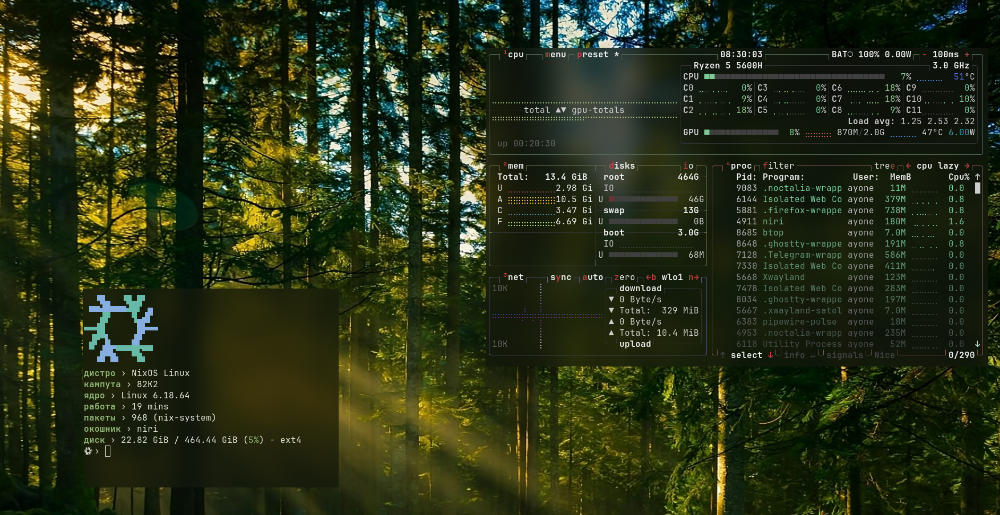

# NixOS: 3 дня использования — промежуточные результаты

Приветствую! В этом посте хочу поделиться результатами первых трёх дней использования NixOS. Базовая настройка завершена, система работает стабильно, и пришло время зафиксировать текущее состояние дел.

### ◼ Прозрачность интерфейса

Удалось настроить эффект прозрачности для нескольких приложений: **Firefox**, **Telegram**, **OBS** и **btop**. Процесс настройки оказался проще, чем ожидалось — достаточно было добавить соответствующие параметры в конфигурацию оконного менеджера. Интерфейс стал выглядеть более современно и легко.

### ◼ Кастомизация fastfetch

Выполнил тонкую настройку утилиты **fastfetch** под свои предпочтения. Результат можно увидеть на скриншоте выше — лаконичный вывод системной информации с кастомным логотипом и цветовым оформлением.

### ◼ Игры и производительность

Установил игру **Freesm**. Процесс компиляции потребовал некоторых усилий, но в итоге игра запустилась и работает стабильно. **Лаги отсутствуют**, производительность на приемлемом уровне. Для Linux-системы это положительный результат.

### ◼ Базовый набор приложений

Добавил несколько необходимых программ:
- **Ark** — архиватор для работы с различными форматами файлов
- **Discord** — мессенджер для общения
- **Audacity** — аудиоредактор для записи голоса

Все приложения работают корректно, конфликтов зависимостей не обнаружено.

### ◼ Мониторинг ресурсов (btop-cuda)

Выявил важную деталь: для корректного отображения информации о видеокартах NVIDIA необходимо использовать пакет **`btop-cuda`** вместо стандартного `btop`. После замены утилита начала показывать обе видеокарты и их текущую нагрузку. **Вопрос решён**.

### ◼ Планы на ближайшее время

Остаётся ещё **3 дня** активного использования системы. Этот период позволит оценить удобство управления пакетами через Nix, протестировать различные сценарии работы и выявить возможные проблемы. По итогам недельного тестирования будет подготовлен финальный отчёт с подробными выводами.

---

Следите за обновлениями в моем Telegram-канале.
