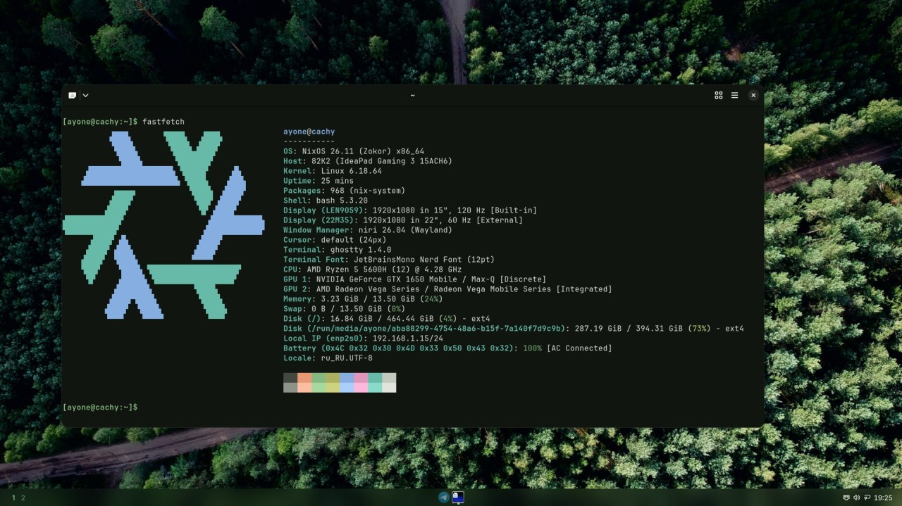

# Я перешел на NixOS. Ну а чё?

**NixOS установлен и работает стабильно.**

**OBS:** поддержка NVENC отсутствовала изначально, но после ручной пересборки **проблема решена**.

**btop:** не отображает видеокарту NVIDIA, **проблема пока не решена**.

**Niri и Noctalia работают корректно**, настроен Blur эффект в Telegram через конфиг WM.

**SSD из старого ноутбука обеспечивает отличную производительность — нет фризов.**

**План: использовать систему неделю для привыкания, затем подвести итоги.**

[Telegram](https://t.me/ayonelinux)
